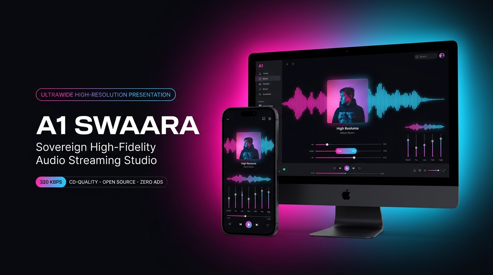
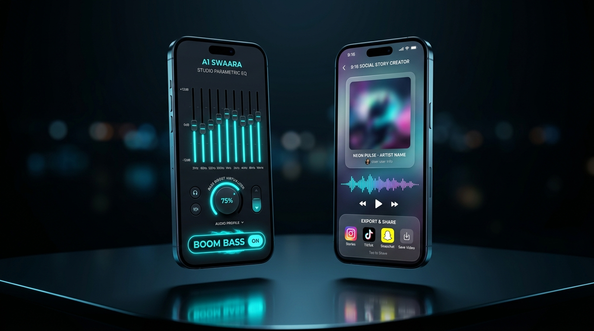

<!-- VARSHUAI-FLAGSHIP-RELEASE -->
# A1 Swaara (Android APK & PC Edition)

> **High-Performance Sovereign Audio Streaming & Studio Suite engineered by @varshuai.**  
> *An open-source flagship audio platform by [VarshuAi](https://github.com/VarshuAi) • Part of the [Velorio Labs](https://github.com/VelorioLabs) Ecosystem.*

<div align="center">

[](LICENSE)
[](https://github.com/Varshuai/A1Swaara_apk/releases/tag/v1.0.9)
[](#downloads--releases)
[](https://github.com/Varshuai)
[](https://github.com/VelorioLabs)

<br/>


</div>

---

## Visual Showcase

<div align="center">
  
  
</div>

---

## Overview

**A1 Swaara** is a modern, obsidian-aesthetic music streaming studio designed for pure audio fidelity, instantaneous streaming up to **320 kbps (CD-Quality)**, synchronized karaoke lyrics, real-time parametric equalization, and sovereign offline caching across both **Android** and **Windows PC**.

```
+------------------------------------------------------------------------+
|  SYSTEM ARCHITECTURE: A1 SWAARA SUITE (ANDROID + PC)                   |
|  MAINTAINER: @varshuai (VARSHAN) * VELORIO LABS                         |
|  SECURITY: DETERMINISTIC * ZERO TELEMETRY TRACKING * PURE 320 KBPS     |
+------------------------------------------------------------------------+
```

---

## Downloads & Releases

### Android Version (v1.0.9)
Download the latest standalone APK directly from the repository:
* **Direct APK Download**: [`A1_Swaara_v1.0.9.apk`](A1_Swaara_v1.0.9.apk) (~36.1 MB)
* **Release Channel**: [GitHub Releases v1.0.9](https://github.com/Varshuai/A1Swaara_apk/releases/tag/v1.0.9)
* **Metadata & OTA Config**: [`version.json`](version.json)

### Windows PC Version
Run natively on Windows desktop:
* **Pre-bundled Launcher**: Double click `launch-swaara-pc.bat`
* **Electron Desktop Engine**: Available in directory `swaara-pc/`

---

## What Is New in v1.0.9

* **Decoupled Offline Downloads**: Streamed tracks are no longer auto-marked as downloaded; only tracks explicitly saved by the user are persisted.
* **Add to Playlist from Player**: Direct playlist picker bottom sheet accessible from both the top action bar and Track Options menu, with inline new playlist creation.
* **Futuristic Animated Loop Button**: 360-degree rotation animation with distinct visual states (Repeat Off, Repeat All in cyan, and Repeat One with a prominent white badge).
* **Mathematically Aligned Controls Deck**: Clean vertical grid alignment across primary and secondary playback controls in portrait and landscape orientations.

---

## Core Feature Comparison

| Feature | A1 Swaara | Spotify Free | YouTube Music | ViMusic |
| :--- | :--- | :--- | :--- | :--- |
| **Audio Ads** | Zero (Never) | Interruptive | Video Ads | Zero |
| **Max Bitrate** | 320 kbps (HQ) | 160 kbps | 256 kbps (Premium) | 256 kbps |
| **Offline Downloads** | Free (Selective) | Paid Premium | Paid Premium | Cache only |
| **Background Playback** | Free (Unlimited) | Restricted | Paid Premium | Free |
| **Karaoke Synced Lyrics**| Built-in Free | Limited | Paid Only | Extension |
| **Studio Equalizer** | 10-Band + Bass | Basic | Basic | 5-Band |
| **Social Story Creator** | Built-in (9:16) | External Share | Static Only | None |
| **Telemetry & Tracking** | Zero (Private) | Extensive | Extensive | Zero |

---

## A1 Swaara PC Edition

The dedicated desktop version of A1 Swaara is engineered with **Electron, React 19, TypeScript, and Vite**, equipped with hardware-accelerated Web Audio API shaping.

### Highlights
* **Obsidian Glass Frameless UI**: Signature dark styling (`#08080C`), ambient dynamic album backlight glow, and custom drag titlebar.
* **Pure YouTube NewPipe Extractor**: Powered by NewPipe InnerTube VisionOS extraction engine with unthrottled direct audio stream resolution.
* **BOOM BASS Studio Equalizer**: 10-Band parametric audio shaping (32Hz to 16kHz) with dedicated resonant sub-harmonic bass pump (`+12 dB`).
* **Real-Time 40-Bar Spectrum Visualizer**: Dynamic audio spectrum visualizer responding directly to live music frequencies.
* **Karaoke Synced Lyrics**: YouTube timestamped transcript extractor with auto-scrolling synchronized karaoke lyrics.
* **Language Discovery Matrix**: 1-click discovery for Kannada, Hindi, English, Punjabi, Tamil, Telugu, Malayalam, and Lo-Fi Chill.
* **1-Click 320 kbps MP3 Downloader**: Saves tracks directly to `Music/A1 Swaara` on your PC for offline listening.
* **Social Story Studio**: Generate 9:16 vertical Instagram and WhatsApp Story cards (exported to PNG) and 60-character vibe status notes.
* **Mini Player & Zen Mode**: Compact floating Picture-in-Picture desktop widget (`380x210`) and immersive distraction-free fullscreen mode (`F`).

### Desktop Keyboard Shortcuts

| Shortcut | Action |
| :--- | :--- |
| `Space` | Play / Pause |
| `Left` / `Right` | Seek Backward / Forward 5 seconds |
| `Up` / `Down` | Volume Up / Down 5% |
| `Shift + N` | Skip to Next Track |
| `Shift + P` | Skip to Previous Track |
| `M` | Mute / Unmute Toggle |
| `F` | Toggle Zen Fullscreen Mode |
| `Esc` | Close Modals / Exit Fullscreen |

---

## Quickstart & Launching PC Version

### Method 1: 1-Click Windows Launcher
Double-click:
```cmd
launch-swaara-pc.bat
```

### Method 2: Manual Terminal Launch
```bash
cd swaara-pc
npm install
npm run dev          # Run in web browser (localhost:5173)
npm run electron     # Run as native Windows desktop app
```

---

## Ecosystem

Explore more cutting-edge sovereign developer tools, security scanners, and AI systems at **[Velorio Labs](https://github.com/VelorioLabs)**:
* **AetherEye** — Tactical Global Satellite & ADS-B Flight Radar Terminal
* **TeleVortex** — Universal Media Decompiler & Transcoder Bot
* **Termux-Vault** — DoD 5220.22-M Multi-Pass File Shredder

---

## Contributing

Contributions are welcome! Please review our [Contributing Guidelines](CONTRIBUTING.md) and [Code of Conduct](CODE_OF_CONDUCT.md).

---

## Security

To report security vulnerabilities responsibly, please review our [Security Policy](SECURITY.md).

---

## License

A1 Swaara is open-source software licensed under the **GNU General Public License v3.0 (GPLv3)**. See the [LICENSE](LICENSE) file for complete details.

---

**A1 Swaara** • Engineered by **[@varshuai](https://github.com/Varshuai)** • Part of **[Velorio Labs](https://github.com/VelorioLabs)**
